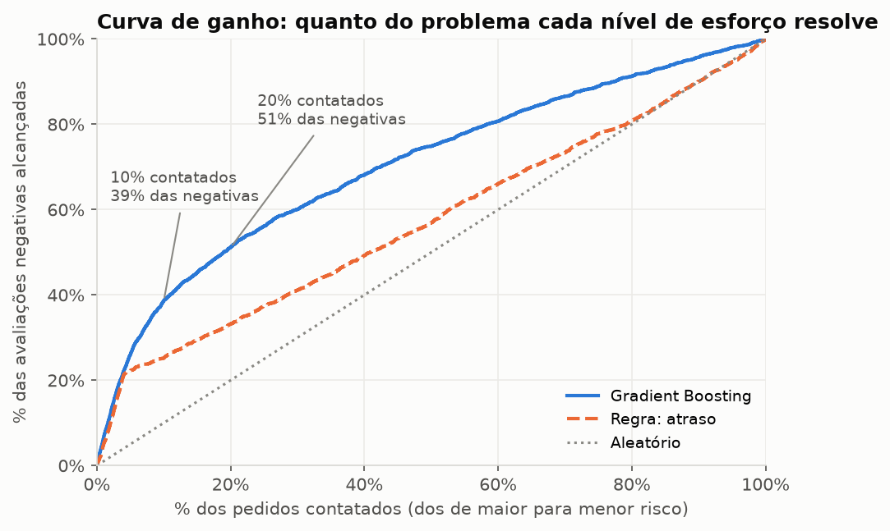
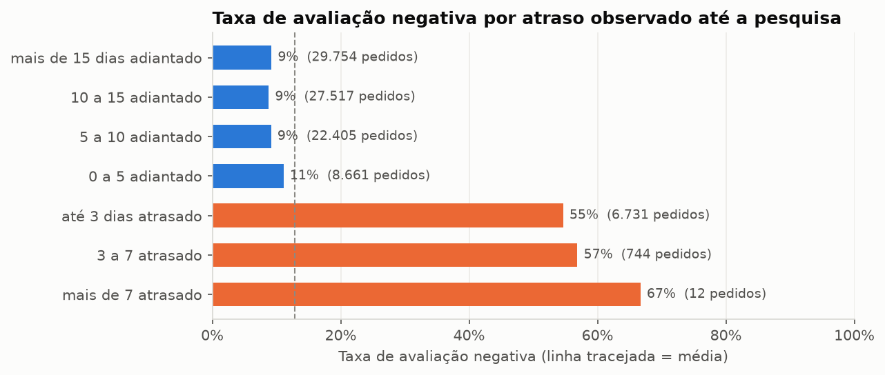

# Previsão de avaliações negativas no e-commerce

Modelo de machine learning que identifica, **antes de o cliente responder a pesquisa de satisfação**, quais pedidos têm maior risco de receber nota 1 ou 2, para que o time de atendimento possa agir a tempo.

Dados reais de cerca de 100 mil pedidos do [Brazilian E-Commerce Public Dataset by Olist](https://www.kaggle.com/datasets/olistbr/brazilian-ecommerce) (2016 a 2018).

## Resultados

| Modelo (teste: jun a ago/2018) | PR-AUC | ROC-AUC |
|---|---|---|
| **Gradient Boosting (final)** | **0,344** | **0,726** |
| Random Forest | 0,339 | 0,724 |
| Regressão logística | 0,310 | 0,709 |
| Regra de negócio: ordenar por atraso | 0,225 | 0,580 |
| Aleatório (taxa base) | 0,103 | 0,500 |

Em termos de negócio:

| Pedidos contatados | Avaliações negativas alcançadas | Precisão | Lift sobre o aleatório |
|---|---|---|---|
| 5% de maior risco | 26% | 54% | 5,2x |
| 10% de maior risco | 39% | 40% | 3,9x |
| 20% de maior risco | 51% | 26% | 2,6x |

Contatando os 10% de pedidos de maior risco, o time alcança cerca de 4 em cada 10 avaliações negativas, e 4 de cada 10 contatos são para clientes que realmente avaliariam mal (ao acaso, seria 1 em 10).



## O ponto central: o momento da previsão

A primeira ideia seria prever "quando o pedido é entregue", usando o atraso real da entrega. A análise dos dados mostrou que isso não funciona: **entre os pedidos atrasados, mais da metade dos clientes respondeu a avaliação antes de receber o produto**, e 80% dessas respostas foram negativas.

Por isso o modelo roda no **envio da pesquisa de satisfação**, e todas as variáveis usam apenas informações anteriores a esse momento. A comparação com a abordagem ingênua mostra a diferença:

| Contatando os 5% de maior risco | Negativas encontradas | Encontradas a tempo de agir |
|---|---|---|
| Modelo ingênuo (roda na entrega) | 574 | 176 |
| **Modelo deste projeto (roda no envio da pesquisa)** | **558** | **558** |

Olhando só a PR-AUC, o modelo ingênuo parece um pouco melhor (0,354 contra 0,344). Na prática, ele permite agir em 3 vezes menos casos, porque aponta justamente os pedidos cujos clientes já avaliaram.

## Principais achados

1. **Logística é o principal motor das notas ruins.** Pedidos ainda não entregues na data da pesquisa têm cerca de 49% de avaliações negativas, contra 9% dos entregues.
2. **Pedidos com mais de um vendedor têm cerca de 47% de avaliações negativas**, quase quatro vezes a média. Mesmo entre pedidos já entregues, ter mais de um item triplica a taxa. A hipótese é entrega parcial: os itens chegam em pacotes separados e o cliente avalia antes de receber tudo.
3. **O histórico do vendedor ajuda**: pedidos dos vendedores com pior histórico têm o dobro da taxa negativa dos melhores, desde que o histórico seja calculado só com o passado.
4. **Entre os pedidos entregues no prazo, a regra de atraso não serve para nada**, enquanto o modelo mais que dobra a taxa base. É o risco que ninguém enxergaria sem o modelo.
5. **O comportamento muda no tempo.** O período de teste teve menos atrasos, e a PR-AUC caiu de 0,48 na validação para 0,34 no teste. Em produção, o modelo precisaria de monitoramento e retreino.



## Decisões técnicas

| Decisão | Motivo |
|---|---|
| Base montada em **SQL (DuckDB)** direto nos CSVs | 8 tabelas relacionais; joins, janelas (`ROW_NUMBER`), `ASOF JOIN` e Haversine para distância |
| **Histórico do vendedor** só com avaliações respondidas antes da pesquisa, com suavização bayesiana | evita vazamento e estabiliza vendedores com poucas avaliações; um teste automático confere |
| **Divisão temporal** (treino até mai/2018, teste de jun a ago/2018) e `TimeSeriesSplit` | em produção o modelo sempre prevê o futuro |
| **PR-AUC** como métrica principal | classe rara (cerca de 13%); a acurácia de "nunca é negativa" seria de 90% |
| **Linhas de base** (aleatório e regra de atraso) | o modelo precisa provar que supera o que um analista faria sem ML |
| **Gradient Boosting** (`HistGradientBoostingClassifier`) | desempenho no nível do Random Forest, 5x mais rápido, trata nulos e categorias sozinho |
| **Limiar pelo custo**: contatar se p > C / (e × V) | o limiar padrão de 0,5 não tem significado de negócio |
| **Importância por permutação** e dependência parcial | interpretar o modelo na métrica que importa, no teste |

## Estrutura

```
├── sql/base_modelagem.sql          # construção da base (uma linha por pedido)
├── src/olist/
│   ├── dados.py                    # leitura dos CSVs e execução do SQL
│   ├── modelagem.py                # variáveis, divisão temporal, pipelines, métricas
│   ├── negocio.py                  # tabela de capacidade e limiar por custo
│   └── graficos.py                 # estilo dos gráficos
├── notebooks/
│   ├── 01_base_e_exploracao.ipynb  # momento da previsão, SQL, qualidade, EDA
│   ├── 02_modelagem.ipynb          # validação, modelos, ajuste, teste, vazamento
│   └── 03_avaliacao_e_negocio.ipynb# calibração, segmentos, decisão, interpretação
├── tests/                          # testes de vazamento e da lógica de negócio
└── reports/                        # figuras e métricas
```

## Como reproduzir

Requer Python 3.11 ou superior.

```bash
# 1. Ambiente
python -m venv .venv
source .venv/bin/activate          # Windows: .venv\Scripts\activate
pip install -r requirements.txt

# 2. Dados: baixe o .zip na página do Kaggle (link acima) e extraia em data/raw/
#    ou, pelo terminal:
curl -L -o olist.zip https://www.kaggle.com/api/v1/datasets/download/olistbr/brazilian-ecommerce
unzip olist.zip -d data/raw

# 3. Testes (confirmam que a base não tem vazamento)
pytest -q

# 4. Notebooks, na ordem
jupyter notebook notebooks/
```

## Limitações e próximos passos

- O modelo cobre apenas pedidos entregues; cancelados exigem outra abordagem.
- As probabilidades ficaram um pouco altas no período de teste; contas de custo exigiriam recalibração com dados recentes.
- O modelo indica quem tem risco, não se o contato funciona. O próximo passo seria um **teste A/B** para medir a efetividade da ação.
- A hipótese de entrega parcial depende de dados de entrega por item, que não existem no dataset.
